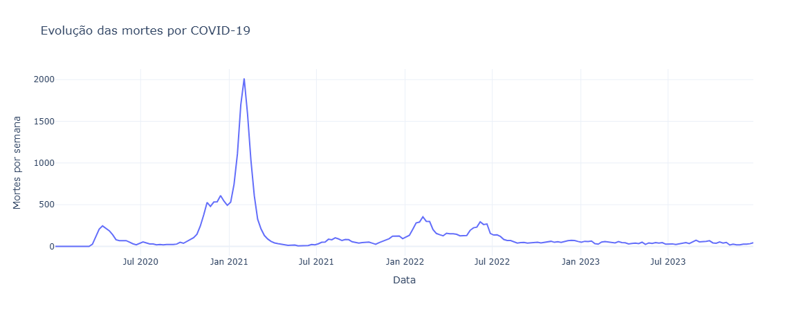
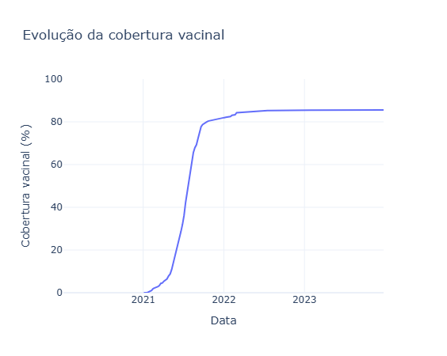
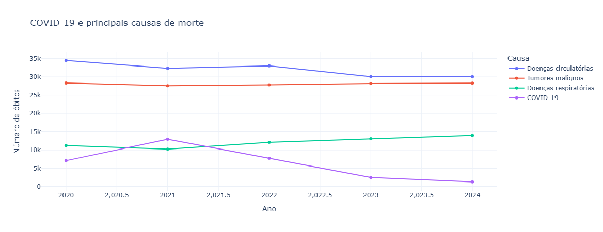
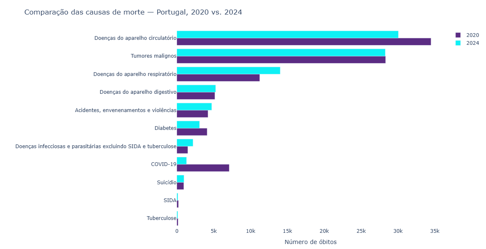
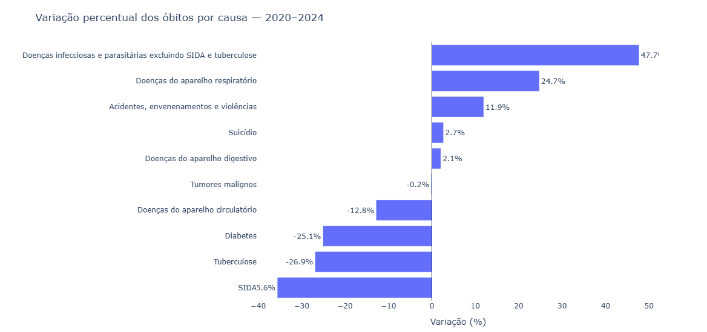
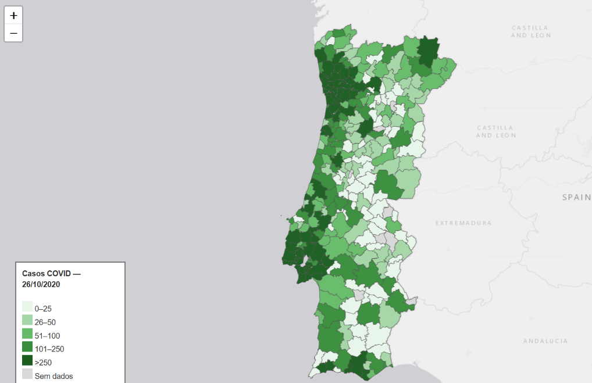
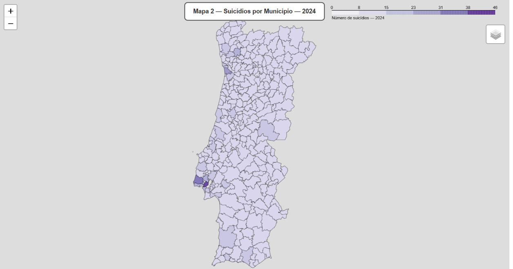

# 🧬 INDICADORES PÓS-PANDEMIA
## Uma Análise Após 5 Anos

  <strong>Uma análise exploratória dos principais indicadores de saúde e mortalidade em Portugal, cinco anos após o período pandémico.</strong>

---

## 🔬 SOBRE O PROJETO

Cinco anos após o início da pandemia, este projeto procura compreender o que aconteceu com alguns dos principais indicadores de saúde e mortalidade em Portugal.

Através da integração de diferentes fontes de dados públicos, são utilizadas técnicas de tratamento, análise estatística, visualização e geoprocessamento para explorar a evolução desses indicadores.

### Pergunta de investigação

> **Após cinco anos do início da pandemia, que alterações podem ser observadas nos principais indicadores de saúde e mortalidade em Portugal?**

### Objetivos

- Analisar a evolução do excesso de mortalidade;
- Observar a evolução das mortes por COVID-19;
- Avaliar a evolução da cobertura vacinal;
- Comparar as principais causas de morte;
- Explorar associações entre indicadores;
- Identificar diferenças na distribuição geográfica dos dados.

---

## 1. OS DADOS

A análise foi construída a partir da integração de diferentes fontes de dados públicos, permitindo observar o período estudado através de várias dimensões.

### Principais fontes

| Fonte | Informação utilizada |
|---|---|
| **Our World in Data** | Excesso de mortalidade, mortes por COVID-19 e vacinação |
| **PORDATA** | Mortalidade por diferentes causas |
| **INE** | Informação estatística complementar |
| **CAOP 2025 — DGT** | Informação geográfica dos municípios |

### Períodos analisados

- **2020–2023:** evolução semanal do excesso de mortalidade, mortes por COVID-19 e cobertura vacinal.
- **2020–2024:** comparação das principais causas de morte.
- **2020:** análise geográfica dos casos de COVID-19 por município.
- **2024:** análise geográfica das causas de morte.

### Dataset final

O conjunto de dados utilizado na análise temporal apresenta:

**208 observações · 4 variáveis**

Período: `06/01/2020 – 25/12/2023`

Variáveis principais:

`data_semana` · `excesso_cumulativo_por_milhao` · `mortes_covid` · `cobertura_vacinal`

## 2. TRATAMENTO DOS DADOS

<h3 align="left">TRATAMENTO DE DADOS</h3>

  <strong>01 · Dados originais</strong> 
  Recolha e integração das fontes de dados. 
  ↓ 
  <strong>02 · Inspeção e compreensão</strong> 
  Análise da estrutura, variáveis e qualidade dos dados. 
  ↓ 
  <strong>03 · Limpeza</strong> 
  Identificação e correção de inconsistências. 
  ↓ 
  <strong>04 · Transformação</strong> 
  Normalização, conversão e preparação das variáveis. 
  ↓ 
  <strong>05 · Integração</strong> 
  Consolidação dos diferentes conjuntos de dados. 
  ↓ 
  <strong>06 · Validação</strong> 
  Verificação da consistência e integridade dos dados. 
  ↓ 
  <strong>07 · Dados preparados para análise</strong>

---

## 3. ANÁLISE ESTATÍSTICA

Foram utilizadas técnicas de estatística descritiva e análise exploratória para compreender a distribuição e a evolução dos indicadores.

### Medidas estatísticas

`Média` · `Mediana` · `Mínimo` · `Máximo` · `Desvio-padrão` · `Quartis` · `IQR` · `Assimetria` · `Coeficiente de variação`

### Evolução temporal

Análise da evolução do excesso de mortalidade, das mortes por COVID-19 e da cobertura vacinal.

### Relações entre indicadores

Exploração das correlações entre os principais indicadores.

> **Correlação não significa causalidade.**

### Causas de morte

Comparação das principais causas de morte em Portugal entre 2020 e 2024, com base nos dados da PORDATA.

---

## 4. ANÁLISE GEOGRÁFICA

A componente geográfica foi desenvolvida com **GeoPandas** e **Folium**, utilizando a Carta Administrativa Oficial de Portugal (CAOP 2025).

**278 municípios de Portugal Continental**

Foram desenvolvidas duas análises cartográficas:

- Distribuição geográfica dos casos de COVID-19;
- Distribuição geográfica das causas de morte em 2024.

---

## 5. VISUALIZAÇÃO DOS RESULTADOS

Os resultados foram integrados num **dashboard interativo desenvolvido com Python, Dash e Plotly**.

O dashboard reúne diferentes perspetivas de análise:

- Evolução temporal;
- Cobertura vacinal e excesso de mortalidade;
- Causas de morte;
- Comparação entre períodos;
- Variação percentual dos óbitos;
- Análise geográfica.

### Gráficos estatísticos

### Mapas temáticos

**Mapa 01 — Distribuição geográfica dos casos de COVID-19**

**Mapa 02 — Distribuição geográfica das causas de morte em 2024**

---

## 6. RESULTADOS

A análise permite observar alterações nos indicadores de mortalidade ao longo do período estudado e identificar padrões que merecem investigação adicional.

A integração das dimensões estatística e geográfica permite ampliar a interpretação dos dados e reconhecer diferenças entre indicadores e territórios.

> **Os dados mostram padrões. A investigação procura compreender as razões.**

---

## 7. REFLEXÃO FINAL

Os resultados são de natureza observacional. O trabalho não tem como objetivo estabelecer relações causais para além do que os dados permitem observar.

O projeto procura identificar sinais, padrões e questões que possam orientar análises futuras na área da saúde pública.

---

## 8. TECNOLOGIAS

**Programação e tratamento de dados:**  
`Python` · `Pandas` · `NumPy`

**Análise e visualização:**  
`Matplotlib` · `Plotly` · `Dash`

**Análise geográfica:**  
`GeoPandas` · `Folium` · `CAOP 2025`

**Ambiente de desenvolvimento:**  
`Jupyter Notebook` · `Spyder`

---

## 9. FONTES

- **Our World in Data** — dados de excesso de mortalidade e COVID-19  
  https://ourworldindata.org/explorers/covid

- **PORDATA** — mortalidade por causas de morte em Portugal  
  https://www.pordata.pt/portugal/obitos+de+residentes+em+portugal+por+algumas+causas-156

- **Instituto Nacional de Estatística (INE)** — estatísticas oficiais de mortalidade  
  https://www.ine.pt/

- **Direção-Geral do Território (DGT)** — CAOP 2025  
  https://www.dgterritorio.gov.pt/carta-administrativa-oficial-de-portugal-caop-2025

---

## 🌐 Dashboard Interativo

<a href="https://indicadores-pos-pandemia-analise-5-anos.onrender.com" target="_blank" rel="noopener noreferrer">
    🚀 Abrir Dashboard Interativo
</a>

---

  

  <strong>🧬 Projeto desenvolvido em Python · Portugal</strong>

  
    No âmbito da UFCD 10809 — Visualização de Dados em Python 
    Prof. Albano Afonso · ETacademy
  

